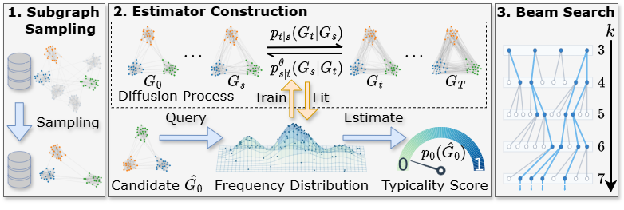

# GraDE

This repository is the official implementation of ["GraDE: A Graph Diffusion Estimator for Frequent Subgraph Discovery in Neural Architectures"](https://openreview.net/forum?id=xDozosGMuJ).

## Overview



**Figure 1.** GraDE combines subgraph sampling, graph diffusion estimator construction, and estimator-guided beam search to discover frequent subgraph patterns.

## Installation

```bash
git clone https://github.com/buaayyk/GraDE.git
cd GraDE

conda create -n GraDE python=3.12 -y
conda activate GraDE
pip install torch torchvision --index-url https://download.pytorch.org/whl/cu126
pip install torch_geometric
pip install overrides scipy scikit-learn python-igraph matplotlib graphviz pynauty torchmetrics pandas rdkit
```

## Data Preparation

Download the datasets from [Datasets](https://zenodo.org/records/23655081) and place them under `./data/`, preserving the following directory names:

```text
data/
├── NASBench101/
├── NASBench201/
├── NASBench301/
├── NASBenchNLP/
├── Younger/
├── YoungerPart/
├── PROTEINS/
└── SocioPatternsHighSchool/
```

`YoungerPart` is the 10% Younger subset used for the $k=5$ results in Table 1. Data loaders reuse existing processed files and prepare missing sampling and processing results from the supplied source data.

## Quick Start

```bash
# DisCo-E
bash script/DisCo/run.sh

# DiGress-E
bash script/DiGress/run.sh

# DeFoG-E
bash script/DeFoG/run.sh

# GraphVAE
bash script/GraphVAE/run.sh

# GNNRanker
bash script/GNNRanker/run.sh

# Sampling-Only
bash script/Sampling_Only/run.sh

# Beam Search
bash script/Beam_Search/run.sh
```

## Citation

```bibtex
@inproceedings{
anonymous2026grade,
title={Gra{DE}: A Graph Diffusion Estimator for Frequent Subgraph Discovery in Neural Architectures},
author={Anonymous},
booktitle={The Fortieth Annual Conference on Neural Information Processing Systems},
year={2026},
url={https://openreview.net/forum?id=xDozosGMuJ}
}
```

## Acknowledgement

Part of our code is borrowed from [DisCo](https://github.com/pricexu/DisCo), [DeFoG](https://github.com/manuelmlmadeira/DeFoG.git), [DiGress](github.com/cvignac/DiGress) and [DiNAS](https://github.com/rohanasthana/DiNAS).
We thank the authors for releasing their code and models.